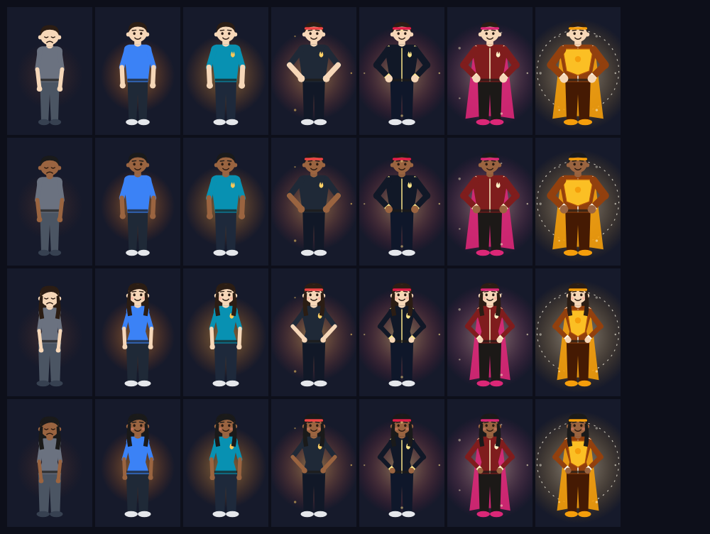

# Ascend

A habit-quitting companion app with an evolving avatar. Every clean day makes your avatar stronger; urges you beat earn XP; slips dim it but never erase your progress.

## Features
- **Evolving avatar**: man, woman or spirit, with 5 skin tones. 7 forms (Ember → Spark → Kindle → Flame → Blaze → Phoenix → Sun); posture and expression follow vitality
- **Live streak counter**: days, hours, minutes and seconds since your last slip, milestones (1, 3, 7, 14 … 1000 days), editable start date
- **Urge button**: log triggers, then pick a reset (box breathing, push-ups, cold water, leave the room, urge surfing) with timers
- **Gentle relapse logic**: streak resets, avatar loses some vitality and 15% XP, keeps its form
- **Insights**: top triggers, urge time-of-day chart, win rate, history
- **Accountability partner**: copy a one-line status (form, level, vitality) with no details
- **Privacy**: neutral name, 4-digit PIN lock, all data stays in the browser (localStorage)

## Run
Open `index.html` in any browser. No build step or dependencies.

Prototype tools in Settings let you fast-forward days to watch the avatar evolve.
